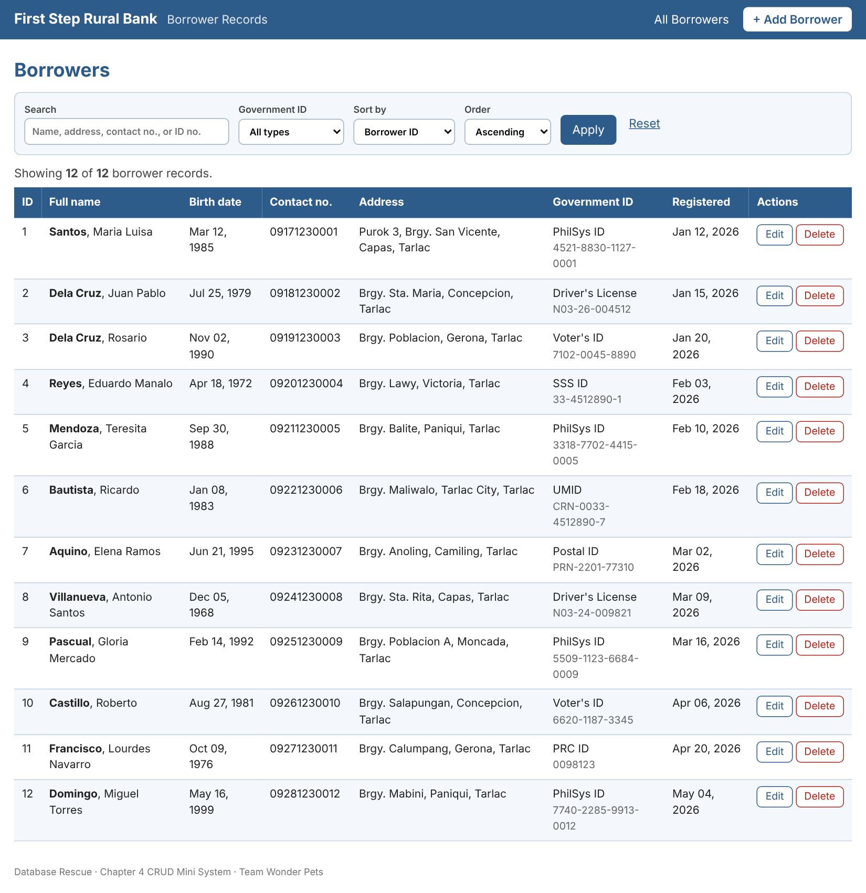
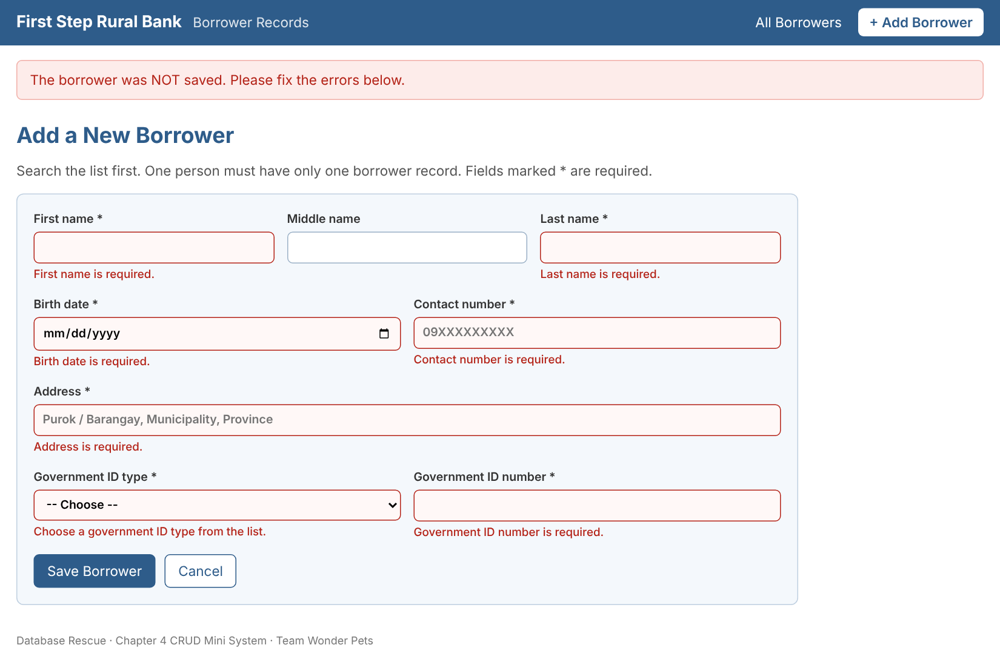
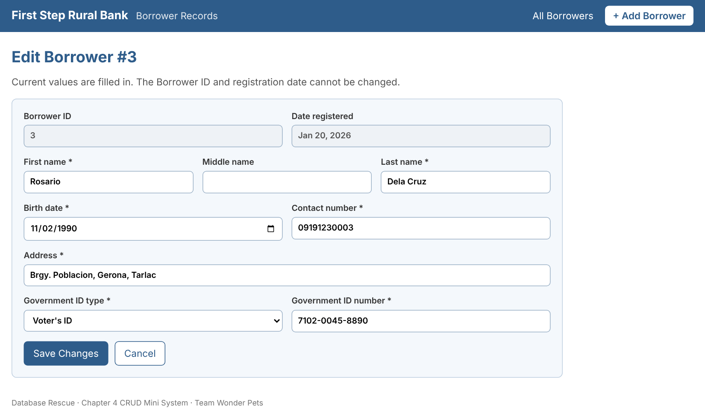
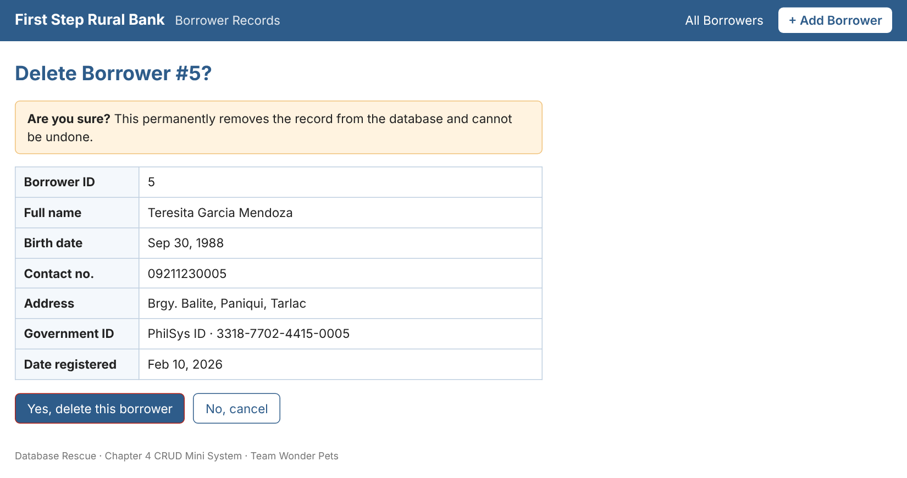

# First Step Rural Bank — Borrower Records (CRUD System)

**Database Rescue · Chapter 4 · Team Wonder Pets**

A small web system that **creates, reads, updates, and deletes** borrower records in a real database. It was built for a case study on *First Step Rural Bank*, a rural microfinance branch whose loan officers could not tell whether a borrower already had other loans, because the same person appeared in the ledgers under slightly different spellings. The system fixes this by keeping **one record per borrower** and rejecting duplicates.

> All names, ID numbers, and addresses in the sample data are fictional.

## Screenshots

| Borrower list (Read) | Add Borrower (Create) |
|---|---|
|  |  |
| **Edit Borrower (Update)** | **Delete confirmation (Delete)** |
|  |  |

More in [`screenshots/`](screenshots/): search, filter and sort, invalid edit, and the list after each change.

## Features

- **Create:** add a borrower with a check on every field. A repeated government ID, or the same name and birth date, is rejected.
- **Read:** list all records; search by name, address, contact number, or ID number; filter by government ID type; sort by ID, last name, birth date, or date registered.
- **Update:** edit form is pre-filled; Borrower ID and registration date are locked; invalid changes are rejected.
- **Delete:** an "Are you sure?" page must be confirmed before a record is removed.
- All SQL uses `?` placeholders (parameterized queries), so typed text can never change the SQL.

## Tech stack

Python 3.10+ · Flask · SQLite · HTML/CSS (Jinja2 templates)

## Run it

```bash
pip install -r requirements.txt
python app.py
```

Then open <http://127.0.0.1:5000>. On Windows you can use `py` instead of `python`.

The first run builds `borrowers.db` from [`database.sql`](database.sql) with 12 sample borrowers. To restore the sample data: `python app.py --reset`.

## Test it

```bash
python tests/run_tests.py
```

Runs 20 test cases (Create, Read, Update, Delete, including invalid input) on a temporary copy of the database and prints the actual result of each. Expected: `20 of 20 test cases passed`.

## Database

Table `Borrower` (from the Chapter 2 design):

| Column | Type | Rules |
|---|---|---|
| BorrowerID | INTEGER | Primary key, auto-increment |
| FirstName | VARCHAR(50) | Required |
| MiddleName | VARCHAR(50) | Optional |
| LastName | VARCHAR(50) | Required |
| BirthDate | DATE | Required, age 18 to 100 |
| ContactNo | VARCHAR(13) | Required, PH mobile number |
| Address | VARCHAR(150) | Required |
| GovIDType | VARCHAR(30) | Required, UNIQUE with GovIDNo |
| GovIDNo | VARCHAR(30) | Required |
| DateRegistered | DATE | Defaults to today |

Also unique: (FirstName, LastName, BirthDate).

## Project structure

```
app.py            Flask app: Create, Read, Update, Delete routes and validation
database.sql      CREATE TABLE + 12 sample records
templates/        list, form (add/edit), delete confirmation, base layout
static/style.css  styling
tests/            run_tests.py (20 test cases), take_screenshots.py (optional helper)
screenshots/      screenshots of every screen
docs/index.html   browser-only copy of the screens (for GitHub Pages)
docs/reports/     term paper and Chapter 4 report (Word)
```

## Online demo (GitHub Pages)

`docs/index.html` is a browser-only copy of the same screens with sample data kept in the browser. After pushing, enable **Settings → Pages → Deploy from a branch → `main` / `/docs`** and it will be available at `https://<your-username>.github.io/<repo-name>/`.

## Team

Wonder Pets: Carpio, Diether Justin · Carpio, Lorman · Apostol, Kim · Tallada, John Lloyd · Magtalas, Richmon
